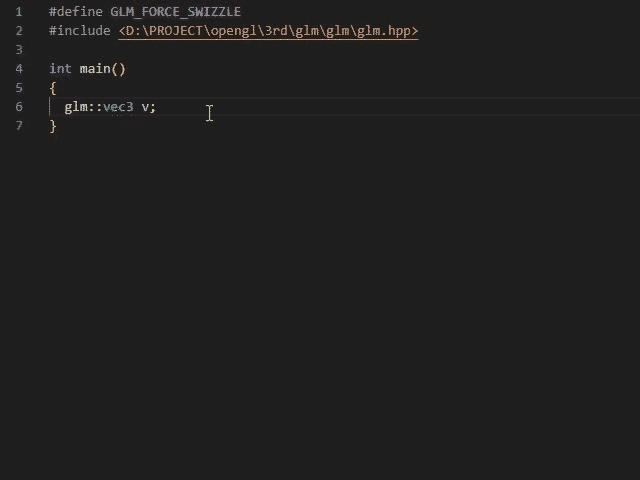

# SpaceElementLibrary

When I work with OpenGL, the swizzle in GLSL is very handy, but in C++, there is no such semantic.  
Some famous libraries do provide swizzle, but none of them fulfills all of my expectations.  
* GLM: with macro GLM_FORCE_SWIZZLE
